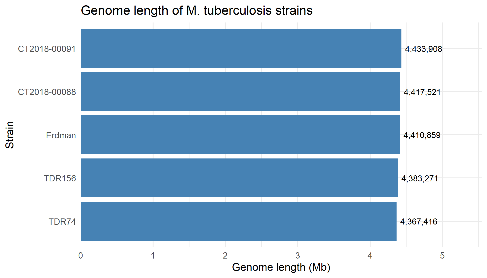
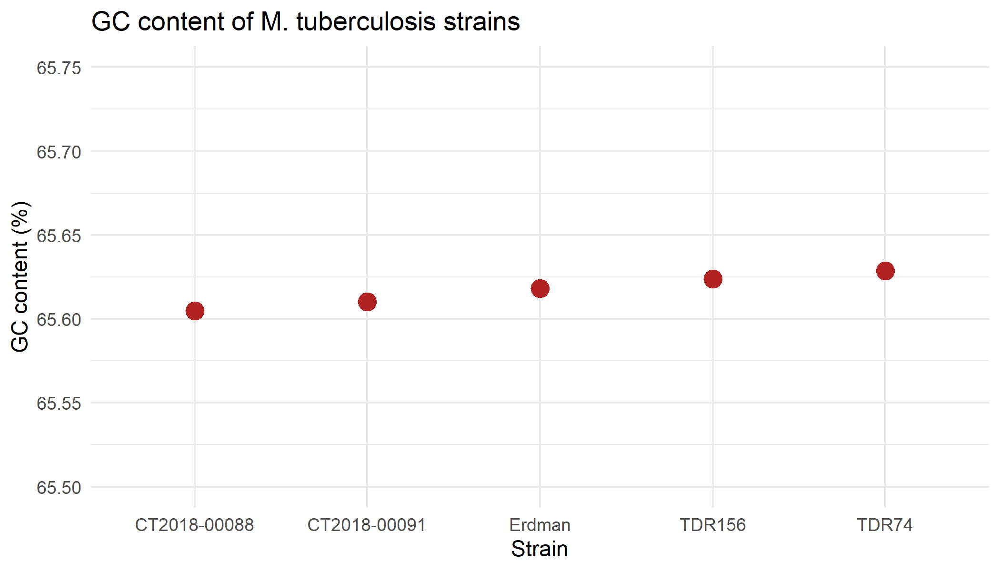
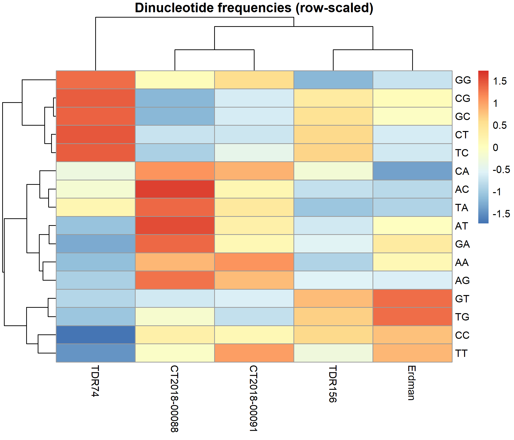
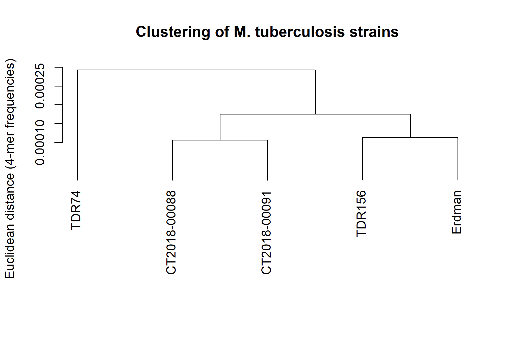
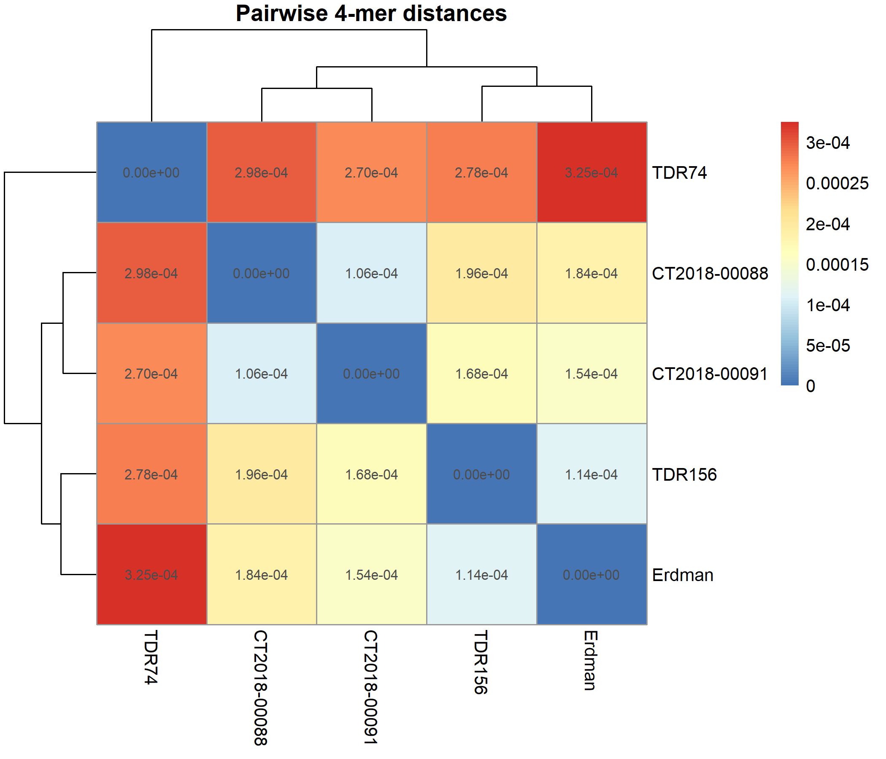

# Comparative Genomic Analysis of *Mycobacterium tuberculosis* Strains Using Alignment-Free k-mer Profiles in R

**Repository / student registration number:** 2021ICT42

## 1. Abstract

Tuberculosis, caused by *Mycobacterium tuberculosis* (Mtb), remains a leading infectious cause of death worldwide. Mtb genomes are highly conserved, so comparing strains needs careful quantitative methods. This project analysed five complete Mtb genomes from NCBI using R. After quality control, genome length, GC content and dinucleotide composition were compared, and strains were clustered using Euclidean distances between 4-mer frequency profiles, an alignment-free approach. Genome lengths ranged from 4.37 to 4.43 Mb (1.5% difference) and GC content from 65.605% to 65.629%. Clustering separated strain TDR74 from the other four and grouped CT2018-00088 with CT2018-00091, and TDR156 with Erdman. The results confirm strong compositional conservation in Mtb, while showing that k-mer profiles still detect small differences between strains. With five genomes and no alignment, the findings are exploratory.

## 2. Introduction

Tuberculosis (TB) is an infectious disease caused by *Mycobacterium tuberculosis*. According to the World Health Organization, around ten million people develop TB every year and more than one million die from it, which makes TB one of the most important infectious diseases globally (WHO, 2024). Understanding how Mtb strains differ at the genome level supports outbreak investigation, the study of drug resistance and vaccine and diagnostic design.

Mtb is unusual among bacterial pathogens. Its genome is about 4.4 million base pairs (Mb), has a very high GC content (about 65.6% in the reference strain H37Rv) and shows little horizontal gene transfer, so strains are close to clonal and differ only by small variations (Cole et al., 1998; Gagneux, 2018). Because strains are so similar, a basic question arises: how much do complete Mtb genomes actually differ in simple, measurable properties, and can these differences group strains meaningfully?

Standard strain comparison uses whole-genome alignment and SNP calling, which needs specialised tools. Alignment-free methods are a simpler alternative. They describe each genome by the frequencies of short DNA words (k-mers) and compare these profiles directly (Zielezinski et al., 2017). This project uses this simple approach, implemented fully in R.

**Aim:** to compare five complete *M. tuberculosis* genomes using genome length, GC content, dinucleotide composition and 4-mer profile clustering.

**Hypothesis:** the five genomes are highly conserved in basic composition (length variation below 2% and GC content within 0.1 percentage points), yet 4-mer profiles are still sensitive enough to separate strains into distinct groups.

## 3. Data

**Source:** NCBI Nucleotide database (nuccore), accessed using the NCBI E-utilities API (Sayers, 2010; Sayers et al., 2022) through the script `code/01_download_data.R`. The search used the organism filter *Mycobacterium tuberculosis* complex (txid1773), the title term "complete genome" and a sequence length of 3.5-5.5 Mb. The first five records returned were downloaded.

**Description:** five complete chromosome sequences in FASTA format (`data/mtb_genomes.fasta`, about 22 MB). The NCBI record identifiers are stored in `data/mtb_ncbi_ids.csv`.

**Variables:** for each genome, the accession number, strain name (from the FASTA header), nucleotide sequence, and derived variables: genome length (bp), GC content (%), dinucleotide frequencies (16 variables) and 4-mer frequencies (256 variables).

| Accession | Strain |
|---|---|
| NZ_CP154696.1 | CT2018-00088 |
| NZ_CP154659.1 | TDR156 |
| NZ_CP154693.1 | CT2018-00091 |
| NZ_CP154668.1 | TDR74 |
| NZ_CP154680.1 | Erdman (ATCC 35801) |

**Ethical and licensing notes:** the data are bacterial genome sequences and contain no human or patient-identifiable information. NCBI data are publicly available and may be reused, but users should follow the NCBI data-use policies and cite the original database records and submitters.

## 4. Methods

The workflow has four steps, each implemented in an R script in the `code/` folder.

1. **Data import (`01_download_data.R`, `02_import_qc_eda.R`).** Sequences were downloaded using base R and read with `readDNAStringSet()` from the **Biostrings** package (Pagès et al.), which stores DNA efficiently and provides fast base-counting functions. Accession and strain names were extracted from the FASTA headers with regular expressions.
2. **Quality control and cleaning (`02_import_qc_eda.R`).** For each genome the script counted A, C, G, T and ambiguous bases, and checked for duplicated accessions and duplicated sequences. Records were kept only if the length was between 3.5 and 5.5 Mb, fewer than 1% of bases were ambiguous, and the accession was unique. These checks make sure that only complete, clean and unique genomes are compared.
3. **Exploratory data analysis (`02_import_qc_eda.R`).** Genome length and GC content were plotted with **ggplot2** (Wickham, 2016). Dinucleotide frequencies were calculated with Biostrings and shown as a row-scaled heatmap with **pheatmap** (Kolde). Scaling by row was used because the raw differences between strains are very small.
4. **Main analysis (`03_kmer_clustering.R`).** Each genome was converted into a vector of 256 relative 4-mer frequencies using `oligonucleotideFrequency()`. A 4-mer length was chosen because, for a 4.4 Mb genome, each of the 256 words occurs about 17,000 times on average, which gives stable frequency estimates. Pairwise Euclidean distances were calculated with `dist()`, and strains were clustered with average-linkage hierarchical clustering (UPGMA) using `hclust()`. Results were shown as a dendrogram and a distance heatmap. The value k = 4 was chosen for simplicity and was not tuned.

All analysis was done in R (R Core Team). Version information is saved automatically in `results/session_info.txt`.

## 5. Results

### 5.1 Quality control

All five genomes passed quality control. There were no duplicated accessions or sequences, no ambiguous bases, and all lengths were within the expected range, so no genome was removed.

**Table 1. Genome length and GC content of the five strains.**

| Strain | Accession | Length (bp) | GC content (%) |
|---|---|---|---|
| CT2018-00088 | NZ_CP154696.1 | 4,417,521 | 65.605 |
| TDR156 | NZ_CP154659.1 | 4,383,271 | 65.624 |
| CT2018-00091 | NZ_CP154693.1 | 4,433,908 | 65.610 |
| TDR74 | NZ_CP154668.1 | 4,367,416 | 65.629 |
| Erdman | NZ_CP154680.1 | 4,410,859 | 65.618 |

### 5.2 Exploratory analysis

The mean genome length was 4,402,595 bp. The shortest genome was TDR74 (4,367,416 bp) and the longest was CT2018-00091 (4,433,908 bp), a difference of 66,492 bp, or about 1.5% (Figure 1). GC content was almost constant, ranging from 65.605% (CT2018-00088) to 65.629% (TDR74), a range of only 0.024 percentage points (Figure 2).



**Figure 1. Genome length of the five *M. tuberculosis* strains in megabases.**



**Figure 2. GC content of the five strains. The y-axis is zoomed to 65.5-65.75% to make very small differences visible.**

Dinucleotide composition was also very similar across strains. For example, the CG dinucleotide made up between 12.730% and 12.748% of all dinucleotides in each genome. The row-scaled heatmap (Figure 3) exaggerates these small differences on purpose, and shows that TDR74 differs most from the other strains.



**Figure 3. Dinucleotide frequencies of the five strains. Each row (dinucleotide) is scaled across strains, so colours show relative, not absolute, differences.**

### 5.3 Clustering based on 4-mer profiles

Pairwise Euclidean distances between 4-mer profiles were very small, between 1.06 × 10⁻⁴ and 3.25 × 10⁻⁴ (Table 2). The two closest strains were CT2018-00088 and CT2018-00091 (1.06 × 10⁻⁴), followed by TDR156 and Erdman (1.14 × 10⁻⁴). TDR74 was the most distant from all other strains.

**Table 2. Pairwise Euclidean distances between 4-mer frequency profiles (× 10⁻⁴).**

| | CT2018-00088 | TDR156 | CT2018-00091 | TDR74 | Erdman |
|---|---|---|---|---|---|
| **CT2018-00088** | 0 | 1.96 | 1.06 | 2.98 | 1.84 |
| **TDR156** | 1.96 | 0 | 1.68 | 2.78 | 1.14 |
| **CT2018-00091** | 1.06 | 1.68 | 0 | 2.70 | 1.54 |
| **TDR74** | 2.98 | 2.78 | 2.70 | 0 | 3.25 |
| **Erdman** | 1.84 | 1.14 | 1.54 | 3.25 | 0 |

Hierarchical clustering produced two pairs, (CT2018-00088, CT2018-00091) and (TDR156, Erdman), which joined at a height of 1.75 × 10⁻⁴. TDR74 joined last at 2.93 × 10⁻⁴ (Figure 4). The same structure is visible in the distance heatmap (Figure 5).



**Figure 4. Average-linkage dendrogram of the five strains based on Euclidean distances between 4-mer frequencies.**



**Figure 5. Heatmap of pairwise 4-mer distances with hierarchical clustering. Values are shown in each cell.**

## 6. Discussion

**Interpretation.** The results support the first part of the hypothesis. Genome length varied by only about 1.5% and GC content by 0.024 percentage points, in line with the conserved genome of Mtb described in earlier work (Cole et al., 1998; Gagneux, 2018). The Erdman genome (4,410,859 bp) is close to the length of the H37Rv reference genome (about 4.41 Mb), and all GC values are close to the expected 65.6%. This also acts as a useful sanity check of the data.

The second part of the hypothesis was also supported: although all distances were very small, 4-mer profiles still separated TDR74 from the other strains and formed two pairs. TDR74 is also the shortest genome and has the highest GC content, so the same strain is an extreme in several measures. With only five genomes, however, this link cannot be tested statistically.

**Real-world implications.** Simple alignment-free comparisons can be run in minutes on a normal computer and could be used as a quick first screen of newly sequenced genomes, for example to check data quality or to flag a strain that differs unusually from others, before more detailed analysis such as SNP-based typing.

**Limitations.**
- *Small sample.* Only five genomes were analysed, and they were the first records returned by an NCBI search, not a designed sample. They do not represent the diversity of Mtb.
- *Clustering is not a phylogeny.* K-mer frequencies measure compositional similarity, not evolutionary descent. Differences can arise from gene content, repeat families or assembly differences. The dendrogram should therefore not be read as an evolutionary tree.
- *No statistical support.* No bootstrap or significance test was used, and the choice of k = 4 was not tuned. Another k could give different groupings.
- *Metadata.* Information such as lineage, drug-resistance profile and place of isolation was not used, so the clusters cannot be linked to biology.
- *Very small distances.* Because distances are tiny, small technical differences could influence the clusters.

## 7. Conclusion and Future Work

Five complete *M. tuberculosis* genomes were imported, cleaned and compared in R. They are highly conserved in length and GC content, but 4-mer profiles can still reveal small differences, with TDR74 clearly separated from the other strains and two closely related pairs.

Possible future work: (1) analyse many more genomes using a defined sampling strategy; (2) compare several k values and test the stability of clusters, for example by bootstrapping; (3) compare the k-mer clustering with a SNP-based phylogeny using packages such as **ape** or **phangorn**; and (4) link clusters to lineage and drug-resistance information.

## 8. Reproducibility

**Requirements:** R (version 4.1 or later) with the packages `Biostrings` (Bioconductor), `ggplot2` and `pheatmap` (CRAN). The scripts install missing packages automatically. The exact R and package versions used for each run are saved in `results/session_info.txt`.

**How to run** (from the repository root, with an internet connection only needed for step 1):

```r
source("code/01_download_data.R")      # optional: downloads data into data/
source("code/02_import_qc_eda.R")      # QC and EDA (Figures 1-3)
source("code/03_kmer_clustering.R")    # k-mer clustering (Figures 4-5)
```

The data files are already included in `data/`, so step 1 can be skipped. Note that a new NCBI search may return different records over time, so the included data files should be used to reproduce the results shown here. Figures are saved in `figures/` and tables in `results/`.

## 9. References

- Cole, S.T. et al. (1998) Deciphering the biology of *Mycobacterium tuberculosis* from the complete genome sequence. *Nature*, 393, 537-544.
- Gagneux, S. (2018) Ecology and evolution of *Mycobacterium tuberculosis*. *Nature Reviews Microbiology*, 16, 202-213.
- Kolde, R. *pheatmap: Pretty Heatmaps*. R package. https://CRAN.R-project.org/package=pheatmap
- Pagès, H., Aboyoun, P., Gentleman, R. and DebRoy, S. *Biostrings: Efficient manipulation of biological strings*. R package (Bioconductor). https://bioconductor.org/packages/Biostrings
- R Core Team. *R: A language and environment for statistical computing*. R Foundation for Statistical Computing, Vienna. https://www.R-project.org/
- Sayers, E. (2010) A general introduction to the E-utilities. In: *Entrez Programming Utilities Help*. National Center for Biotechnology Information, Bethesda (MD).
- Sayers, E.W. et al. (2022) Database resources of the National Center for Biotechnology Information. *Nucleic Acids Research*, 50, D20-D26.
- NCBI Nucleotide database (GenBank/RefSeq), accessions NZ_CP154696.1, NZ_CP154659.1, NZ_CP154693.1, NZ_CP154668.1 and NZ_CP154680.1. https://www.ncbi.nlm.nih.gov/nuccore
- Wickham, H. (2016) *ggplot2: Elegant Graphics for Data Analysis*. Springer, New York.
- World Health Organization (2024) *Global tuberculosis report 2024*. Geneva: WHO.
- Zielezinski, A. et al. (2017) Alignment-free sequence comparison: benefits, applications, and tools. *Genome Biology*, 18, 186.
