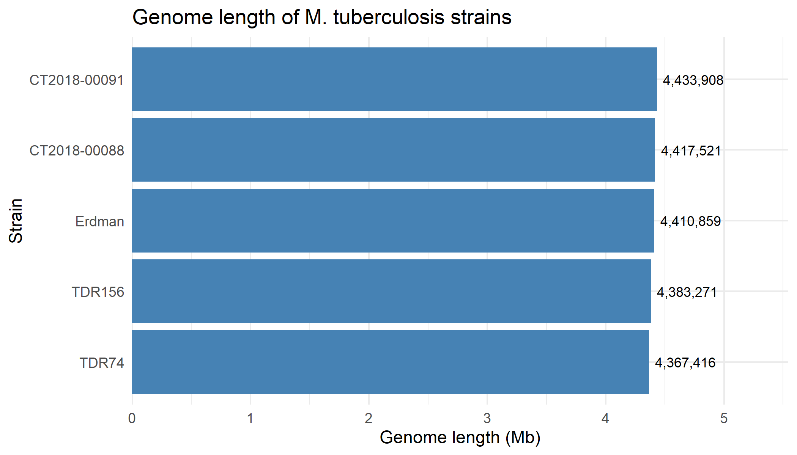
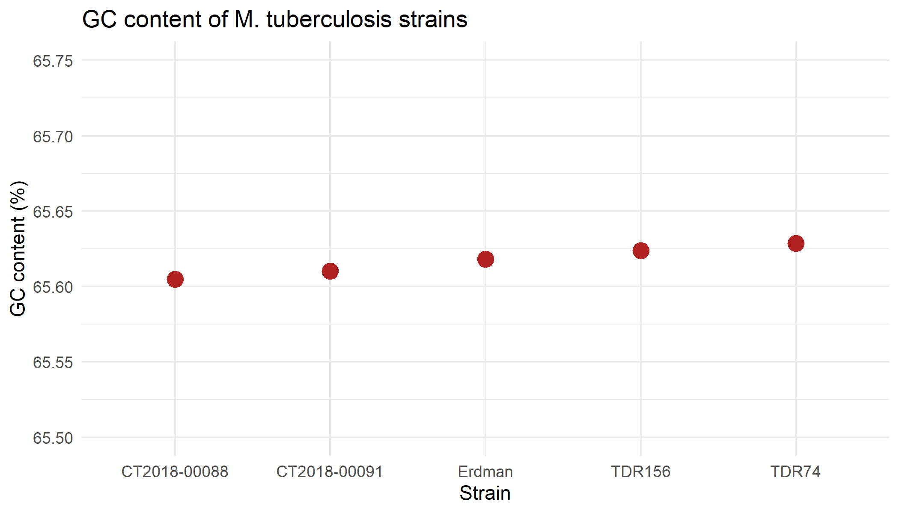
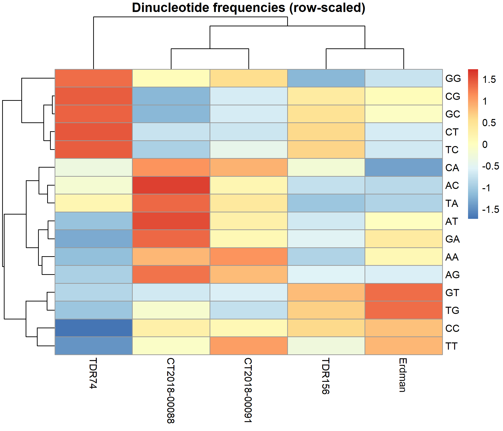
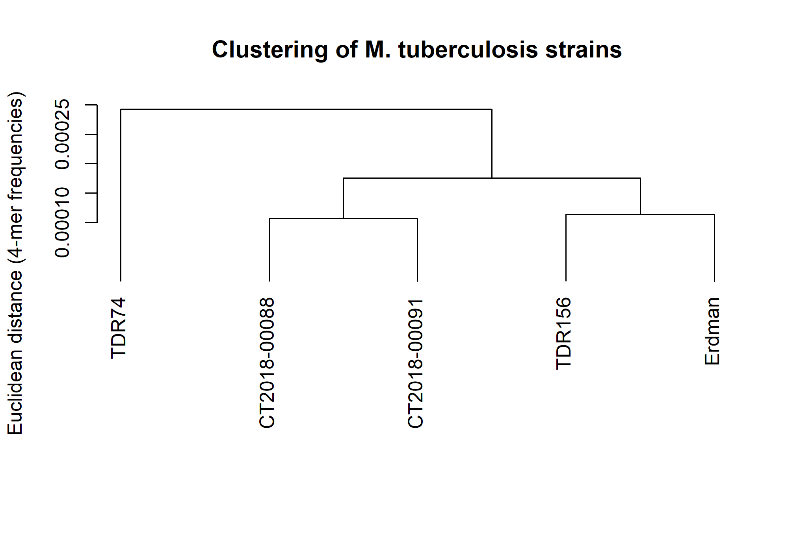
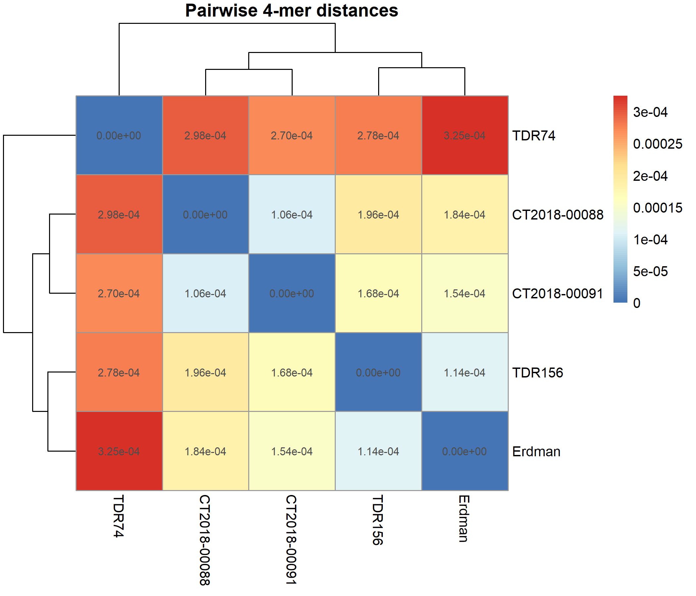

---
title: "Comparative Genomic Analysis of Mycobacterium tuberculosis Strains Using Alignment-Free k-mer Profiles"
author: "2021ICT42"
date: "`r Sys.Date()`"
output:
  html_document:
    toc: true
    toc_depth: 3
    number_sections: true
    theme: readable
    df_print: paged
---

```{r setup, include=FALSE}
knitr::opts_chunk$set(
  echo = FALSE,
  warning = FALSE,
  message = FALSE,
  fig.align = "center",
  out.width = "90%"
)

library(knitr)

# Check required project files
required_files <- c(
  "data/mtb_genomes.fasta",
  "results/qc_summary.csv",
  "results/dinucleotide_frequencies.csv",
  "results/kmer4_distance_matrix.csv"
)

missing_files <- required_files[!file.exists(required_files)]

if (length(missing_files) > 0) {
  stop("Missing project files: ", paste(missing_files, collapse = ", "))
}

qc <- read.csv("results/qc_summary.csv")
dinuc <- read.csv("results/dinucleotide_frequencies.csv",
                  row.names = 1, check.names = FALSE)
dist_mat <- read.csv("results/kmer4_distance_matrix.csv",
                     row.names = 1, check.names = FALSE)

qc$genome_length_mb <- qc$length_bp / 1e6
```

# 1. Abstract

Tuberculosis, caused by *Mycobacterium tuberculosis* (Mtb), remains an important global infectious disease. Comparing bacterial genomes can help researchers understand genomic similarities and differences between strains.

This project analyses five complete *M. tuberculosis* genomes obtained from the NCBI Nucleotide database. The analysis was performed using R and included genome length, GC content, dinucleotide composition and alignment-free 4-mer frequency analysis.

Quality control was performed before the main analysis. Euclidean distances between 4-mer frequency profiles were calculated, followed by average-linkage hierarchical clustering.

The results showed that the five genomes have highly similar basic genomic composition. However, 4-mer frequency profiles identified differences between the strains and revealed clustering relationships. These findings demonstrate the usefulness of alignment-free methods for exploratory genomic comparison.

# 2. Introduction

Tuberculosis (TB) is an infectious disease caused by *Mycobacterium tuberculosis*. It remains a major public health concern worldwide.

The genome of *M. tuberculosis* is approximately 4.4 million base pairs long and has a high GC content of around 65.6%. Although different strains share many genomic characteristics, small variations can exist between them.

Traditional genomic comparison methods often use sequence alignment. However, alignment-free methods provide another approach by comparing the frequencies of short DNA sequences called k-mers.

In this project, five complete *M. tuberculosis* genomes were compared using genome composition and 4-mer frequency profiles.

## 2.1 Aim

To compare five complete *Mycobacterium tuberculosis* genomes using genome length, GC content, dinucleotide composition and alignment-free k-mer clustering.

## 2.2 Objectives

- Obtain five complete genome sequences from NCBI.
- Import and perform quality control on the genomic data.
- Compare genome length and GC content.
- Analyse dinucleotide frequencies.
- Calculate 4-mer frequency profiles.
- Identify genomic similarities and differences using hierarchical clustering.

## 2.3 Hypothesis

The five *M. tuberculosis* genomes are expected to show highly conserved basic genomic composition, while 4-mer frequency profiles may identify small differences between strains.

# 3. Dataset Description

The genomic sequences were obtained from the NCBI Nucleotide database using the NCBI E-utilities API.

Five complete chromosome sequences were downloaded and stored in FASTA format.

The dataset is available in:

`data/mtb_genomes.fasta`

The accession identifiers are stored in:

`data/mtb_ncbi_ids.csv`

## 3.1 Selected Genomes

```{r genome-table}
kable(
  qc[, c("accession", "strain")],
  caption = "The five Mycobacterium tuberculosis genomes used in this project"
)
```

## 3.2 Dataset Variables

The analysis used the following information:

- Accession number
- Strain name
- DNA nucleotide sequence
- Genome length
- GC content
- Dinucleotide frequencies
- 4-mer frequency profiles

The dataset contains bacterial genome sequences and does not contain human patient-identifiable information.

# 4. Methodology

The project was implemented using R programming language.

The workflow consisted of data import, quality control, exploratory data analysis, k-mer frequency calculation and hierarchical clustering.

## 4.1 Data Import

The FASTA file was imported using the `readDNAStringSet()` function from the Biostrings package.

Accession numbers and strain names were extracted from the FASTA headers.

## 4.2 Quality Control and Cleaning

Quality control was performed to identify unsuitable genomic sequences.

The following checks were applied:

- Genome length between 3.5 and 5.5 million base pairs.
- Ambiguous bases below 1%.
- Unique accession numbers.
- Duplicate sequence identification.

All five genomes passed the implemented quality control filters. No genomes were removed.

## 4.3 Genome Composition Analysis

Genome length and GC content were calculated for each strain.

GC content was calculated using:

\[
GC\% = \frac{G+C}{A+T+G+C}\times100
\]

These measurements were used to compare the basic genomic composition of the selected strains.

## 4.4 Dinucleotide Frequency Analysis

Dinucleotide frequencies were calculated using the Biostrings package.

The 16 possible combinations of two DNA nucleotides were examined.

A row-scaled heatmap was generated to visualize relative differences between the strains.

## 4.5 4-mer Frequency Analysis

A 4-mer is a sequence containing four consecutive DNA nucleotides.

There are 256 possible 4-mer combinations because:

\[
4^4 = 256
\]

The relative frequency of each possible 4-mer was calculated for every genome using `oligonucleotideFrequency()`.

## 4.6 Distance Calculation and Clustering

Euclidean distances were calculated between the 4-mer frequency profiles using the `dist()` function.

Hierarchical clustering was performed using average linkage (UPGMA) with the `hclust()` function.

The results were visualized using a dendrogram and a pairwise distance heatmap.

# 5. Results

## 5.1 Quality Control Results

All five genomes passed the quality control filters.

No ambiguous bases or duplicated sequences were identified in the selected genomes.

```{r qc-results}
kable(
  qc[, c("strain", "length_bp", "gc_percent", "other")],
  digits = 3,
  col.names = c("Strain", "Length (bp)", "GC Content (%)",
                "Ambiguous Bases"),
  caption = "Quality control summary of the five genomes"
)
```

## 5.2 Genome Length Analysis

Genome length was calculated for each selected strain.

```{r genome-length}

```

**Figure 1.** Genome length of the five *Mycobacterium tuberculosis* strains in megabases.

The genome lengths ranged from approximately 4.37 Mb to 4.43 Mb.

The shortest genome was TDR74, while CT2018-00091 had the longest genome.

The difference between the shortest and longest genomes was approximately 1.5%.

## 5.3 GC Content Analysis

GC content was calculated to examine the nucleotide composition of each genome.

```{r gc-content}

```

**Figure 2.** GC content of the five *Mycobacterium tuberculosis* strains.

GC content ranged from approximately 65.605% to 65.629%.

The small variation indicates that the selected genomes have highly similar GC composition.

## 5.4 Dinucleotide Frequency Analysis

Dinucleotide frequencies were calculated for all five genomes.

```{r dinucleotide-heatmap}

```

**Figure 3.** Row-scaled heatmap showing dinucleotide frequency differences between the five strains.

The heatmap illustrates relative differences in dinucleotide composition.

The row scaling helps visualize small differences between strains. Therefore, the colours should not be interpreted as absolute frequency values.

## 5.5 4-mer Clustering Analysis

Each genome was represented using a frequency profile containing 256 possible 4-mers.

Euclidean distances were calculated between the profiles.

### Pairwise Distance Matrix

```{r distance-matrix}
kable(
  round(dist_mat, 7),
  caption = "Pairwise Euclidean distances between 4-mer frequency profiles"
)
```

The smallest distance was observed between CT2018-00088 and CT2018-00091.

The largest distance was observed between TDR74 and Erdman.

### Hierarchical Clustering

```{r dendrogram}

```

**Figure 4.** Hierarchical clustering dendrogram based on 4-mer frequency profiles.

The clustering results identified two closely related pairs:

- CT2018-00088 and CT2018-00091.
- TDR156 and Erdman.

TDR74 joined the other strains at a higher clustering distance.

### Distance Heatmap

```{r distance-heatmap}

```

**Figure 5.** Heatmap showing pairwise distances between the five genomic 4-mer profiles.

The heatmap provides a visual representation of the genomic composition distances and supports the clustering results.

# 6. Discussion

The analysis demonstrated that the five selected *Mycobacterium tuberculosis* genomes have highly conserved basic genomic characteristics.

Genome length varied by approximately 1.5%, while GC content showed only a very small variation of 0.024 percentage points.

These findings are consistent with the expected conserved genomic composition of *M. tuberculosis*.

The 4-mer analysis identified differences that were not obvious from genome length and GC content alone.

CT2018-00088 and CT2018-00091 formed the closest pair based on their 4-mer profiles. TDR156 and Erdman also showed a close relationship. TDR74 was the most distant strain from the others.

However, these findings should be interpreted carefully. Only five genomes were analysed, and the clustering was based on nucleotide composition rather than whole-genome alignment or SNP analysis.

Therefore, the observed clustering should not be considered definitive evidence of evolutionary relationships.

# 7. Limitations

This project has several limitations:

1. Only five *M. tuberculosis* genomes were included.
2. The analysis used alignment-free k-mer profiles rather than whole-genome alignment.
3. The 4-mer frequency method captures sequence composition but does not directly identify individual mutations.
4. The selected value of k = 4 was not optimized or compared with other k-mer sizes.
5. The clustering results are exploratory and require further validation using larger datasets and additional genomic methods.

# 8. Conclusion

This project successfully applied R-based bioinformatics methods to compare five complete *Mycobacterium tuberculosis* genomes.

Genome length, GC content and dinucleotide frequencies demonstrated strong compositional similarity between the selected strains.

The 4-mer frequency analysis and hierarchical clustering identified differences in genomic composition and grouped the strains into closely related pairs.

Overall, alignment-free k-mer analysis provides a useful and relatively simple approach for exploratory genomic comparison.

Future work could include a larger genome dataset, different k-mer sizes, whole-genome alignment and SNP-based analysis.

# 9. Reproducibility

The project contains three main R scripts:

| Script | Purpose |
|---|---|
| `01_download_data.R` | Download genomic sequences from NCBI |
| `02_import_qc_eda.R` | Data import, quality control and exploratory analysis |
| `03_kmer_clustering.R` | 4-mer analysis and hierarchical clustering |

The original FASTA dataset is stored in the `data/` folder.

Generated figures are stored in the `figures/` folder, while CSV results and session information are stored in the `results/` folder.

To reproduce the analysis, run the scripts from the repository root directory in the following order:

1. `code/01_download_data.R` (only when downloading the dataset again).
2. `code/02_import_qc_eda.R`.
3. `code/03_kmer_clustering.R`.

The R environment and package version information is available in `results/session_info.txt`.

# 10. References

1. Cole, S. T. et al. (1998). Deciphering the biology of Mycobacterium tuberculosis from the complete genome sequence. *Nature*, 393, 537–544.

2. Gagneux, S. (2018). Ecology and evolution of Mycobacterium tuberculosis. *Nature Reviews Microbiology*.

3. Sayers, E. (2010). A general introduction to the E-utilities. National Center for Biotechnology Information.

4. Sayers, E. W. et al. (2022). Database resources of the National Center for Biotechnology Information. *Nucleic Acids Research*, 50, D20–D26.

5. Wickham, H. (2016). *ggplot2: Elegant Graphics for Data Analysis*. Springer.

6. World Health Organization (2024). *Global Tuberculosis Report 2024*. Geneva: WHO.

7. Zielezinski, A. et al. (2017). Alignment-free sequence comparison: benefits, applications, and tools. *Genome Biology*, 18, 186.

8. NCBI Nucleotide Database. GenBank/RefSeq accession records used in this project: NZ_CP154696.1, NZ_CP154659.1, NZ_CP154693.1, NZ_CP154668.1 and NZ_CP154680.1.

9. Pagès, H. et al. *Biostrings: Efficient manipulation of biological strings*. Bioconductor.

10. R Core Team. *R: A language and environment for statistical computing*. R Foundation for Statistical Computing.
